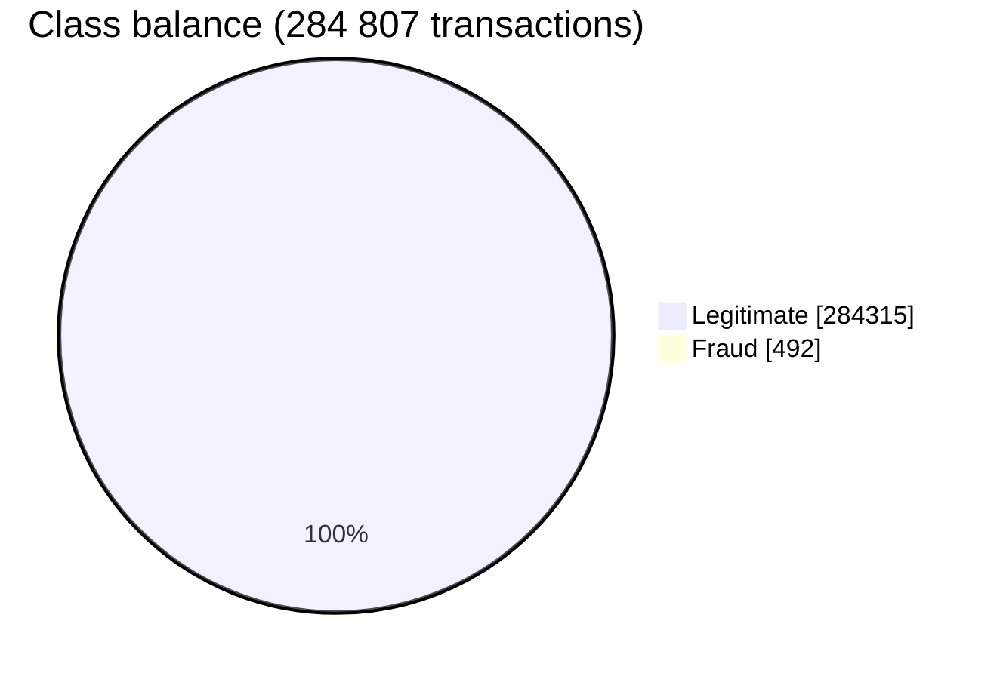
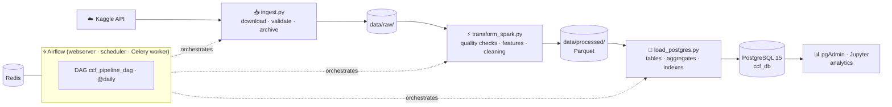
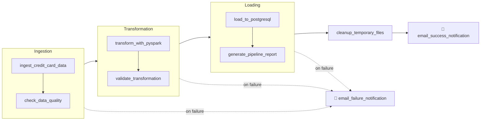
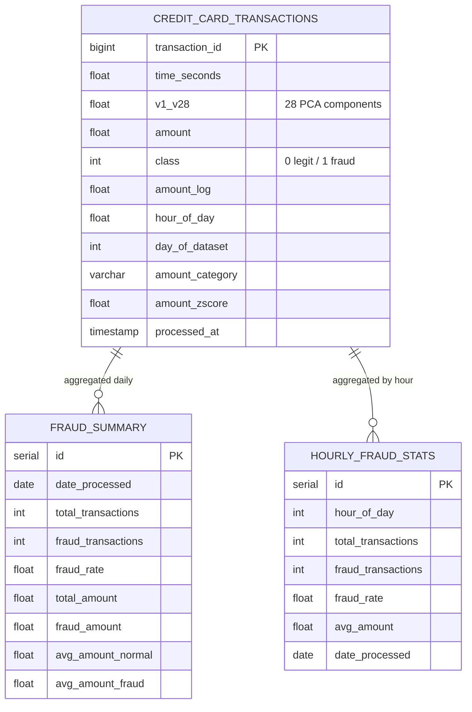

<div align="center">

# 💳 Credit Card Fraud — Data Engineering Pipeline

**End-to-end, Airflow-orchestrated batch pipeline: Kaggle ingestion → PySpark feature engineering → PostgreSQL fraud analytics, fully containerized.**

[](https://www.python.org/)
[](https://airflow.apache.org/)
[](https://spark.apache.org/)
[](https://www.postgresql.org/)
[](https://redis.io/)
[](project-ccf/docker/docker-compose.yml)
[](https://www.kaggle.com/mlg-ulb/creditcardfraud)

</div>

---

## 🎯 Overview

The [ULB credit-card fraud dataset](https://www.kaggle.com/mlg-ulb/creditcardfraud) contains **284 807** European card transactions over two days, of which only **492 (0.17 %) are frauds** — 28 PCA components (`V1…V28`), `Time`, `Amount`, `Class`.

This project builds the **data platform** around it: reproducible daily ingestion, quality gates, Spark feature engineering, and an analytics-ready PostgreSQL schema that fraud analysts and ML models can query.



---

## 🏗️ Architecture



---

## 🔄 Airflow DAG



---

## 🧪 Feature engineering (PySpark)

| Feature | Definition |
|---|---|
| `transaction_id` | `monotonically_increasing_id()` |
| `hour_of_day` | `(Time mod 86 400) / 3 600` |
| `day_of_dataset` | `Time / 86 400` |
| `amount_log` | `log(Amount)` when `Amount > 0` |
| `amount_category` | `zero` · `low ≤ 50` · `medium ≤ 200` · `high ≤ 1 000` · `very_high` |
| `amount_zscore` | `(Amount − μ) / σ` |
| `processed_at` | load timestamp |

---

## 🗃️ Warehouse



Indexes on `class`, `hour_of_day`, `amount`, `processed_at` and the summary dates keep analyst queries fast.

---

## 🚀 Quick start

```bash
cd project-ccf
cp .env.template .env            # Postgres + Kaggle credentials
make setup                       # venv + dependencies
make start                       # Postgres, pgAdmin, Redis, Airflow (web/scheduler/worker), Jupyter
make airflow-trigger             # run the DAG
```

Or step by step without Airflow:

```bash
make pipeline                    # = make ingest transform load
make test                        # pytest (12 tests)
make db-connect                  # psql into ccf_db
```

| Service | URL |
|---|---|
| Airflow | http://localhost:8080 |
| pgAdmin | http://localhost:5050 |
| PostgreSQL | localhost:5432 |

---

## 📁 Project structure

```
project-ccf/
├── dags/ccf_pipeline_dag.py     # Task groups, quality gates, e-mail alerts
├── scripts/
│   ├── ingest.py                # Kaggle download, validation, archiving
│   ├── transform_spark.py       # Quality checks, feature engineering, Parquet
│   └── load_postgres.py         # Schema, bulk load, aggregates, indexes
├── docker/                      # docker-compose + Airflow image
├── tests/test_pipeline.py
├── Makefile                     # 30 developer commands
└── .env.template
```

---

<div align="center">

**Mohamed Abi** · [GitHub @mohamedabi17](https://github.com/mohamedabi17)

</div>
